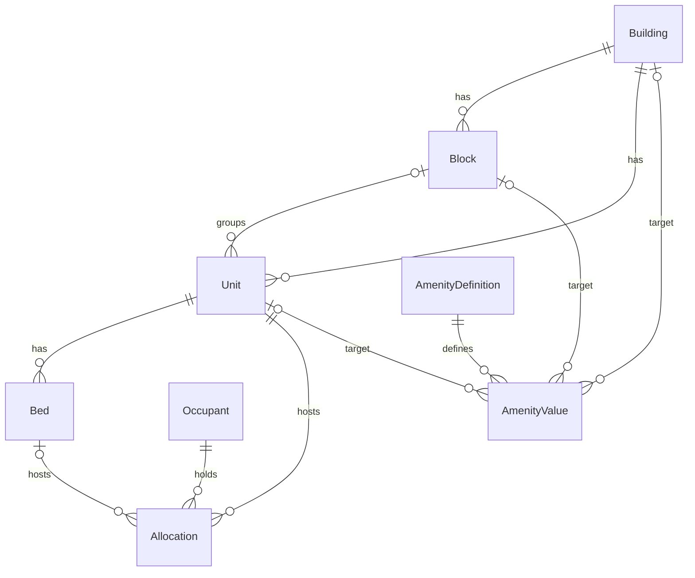

# Data Model

8 models, all inheriting `TimeStampedModel` (`created_at`, `updated_at`). Enums live in `constants.py`.

## 1. Hierarchy

```
Building ──┬── Block (optional) ──┬── Unit ── Bed (hostels only)
           └──────────────────────┘
           (a Unit may attach straight to the Building)

Occupant ── Allocation ── Unit / Bed
AmenityDefinition ── AmenityValue ── (Building | Block | Unit)
```



## 2. Enums

| Enum | Values |
|---|---|
| `PropertyType` | `HOSTEL_BOYS`, `HOSTEL_GIRLS`, `SHOP_COMPLEX`, `TEACHER_QUARTERS` |
| `HOSTEL_PROPERTY_TYPES` | the two hostel types (the only ones allowed capacity > 1 / beds) |
| `UnitStatus` | `VACANT`, `PARTIAL`, `OCCUPIED`, `MAINTENANCE` |
| `BedStatus` | `VACANT`, `OCCUPIED`, `MAINTENANCE` |
| `OccupantType` | `STUDENT`, `TEACHER`, `SHOPKEEPER` |
| `Gender` | `M`, `F` |
| `AllocationStatus` | `ACTIVE`, `VACATED`, `CANCELLED` |
| `AmenityLevel` | `BUILDING`, `BLOCK`, `UNIT` |
| `AmenityValueType` | `BOOLEAN`, `NUMBER`, `TEXT` |

## 3. Models

### Building
`name`, `property_type`, `location`, `is_active`, `created_by` (PROTECT).

### Block (optional layer)
`building` (CASCADE), `name`, `is_active`, `created_by`. **Unique** `(building, name)`.

### Unit (room / shop / quarter)
| Field | Notes |
|---|---|
| `building` | always set (CASCADE) |
| `block` | nullable; must belong to the same building |
| `number` | "Room No" / "Shop No" is a display label derived from `building.property_type` |
| `capacity` | positive int, default 1 |
| `status` | stored, service-managed |
| `floor`, `area_sqft`, `monthly_rent` | optional |
| `is_active`, `created_by` | |

Constraints: **unique** `(building, number)` · **CHECK** `capacity >= 1`.
`clean()`: block ↔ building match; `capacity > 1` only for hostel types.

### Bed
`unit` (CASCADE), `bed_number`, `status`, `is_active`. **Unique** `(unit, bed_number)`.
Exists only when `unit.capacity > 1`. Removed beds are soft-deleted (`is_active=False`) and keep their number.

### Occupant
`occupant_type`, `full_name`, `gender` (M/F, blank allowed; **required for students**, enforced in
serializer + services), `contact_number`, `email`, `external_ref_id` (generic nullable string; student
soft-link to the ERP, unused for now), `is_active`, `created_by`.

### Allocation
`occupant`, `unit`, `bed` (nullable), `allocated_by` (PROTECT), `start_date`, `end_date` (nullable),
`status`. Never deleted.

Constraints:
- **UNIQUE** `(bed)` where `status='ACTIVE'` — one active allocation per bed
- **UNIQUE** `(unit)` where `status='ACTIVE' AND bed IS NULL` — one active allocation per single-capacity unit
- **CHECK** `end_date IS NULL OR end_date >= start_date`

`clean()`: bed required if `capacity > 1`, forbidden if `capacity == 1`, bed belongs to unit, end ≥ start.

### AmenityDefinition (catalog)
`name`, `level`, `value_type`, `applicable_property_types` (JSON list; empty = all types), `is_active`,
`created_by`. **Unique** `(name, level)`.
`clean()`: list of valid `PropertyType` values.
**Lock rule:** `level` and `value_type` cannot change once any value exists (serializer + admin
read-only). Create a new definition instead.

### AmenityValue
`definition`, exactly one of `building` / `block` / `unit`, plus `value_boolean` / `value_number` /
`value_text` (only the one matching `definition.value_type` may be set and it must be non-empty).
Constraints: **CHECK** exactly one target · three **partial UNIQUEs** `(definition, building)`,
`(definition, block)`, `(definition, unit)`.
> `unique_together` over nullable columns never fires in SQL (NULLs are distinct), hence the partial uniques.
Current state only: edits overwrite, no history.
`clean()`: target level matches `definition.level`; `applicable_property_types` includes the target's building type.

## 4. Invariants worth remembering

- `unit.capacity == count(active beds)` for bedded hostel units (min 2 beds); single-capacity units have no active beds.
- A unit with ACTIVE allocations cannot switch between capacity 1 and > 1.
- Bed/unit `status` always equals what live allocations imply, except `MAINTENANCE`, which is set manually.

## 5. Migrations

| Migration | Content |
|---|---|
| `0001_initial` | all 8 models |
| `0002_constraints_and_validation` | drops `AmenityValue.unique_together`; adds amenity partial uniques + exactly-one-target check, unit capacity check, allocation date check; adds `Occupant.gender` |
| `0003_create_groups` | data migration creating `estate_admin` and `hall_assistant` |

Generate new ones with `uv run python manage.py makemigrations estate -n <name>`.
`CheckConstraint(condition=...)` requires Django ≥ 5.1. If dev data has duplicate amenity values or bad
dates, clean them before migrating.
